# epuck-remote

[](https://github.com/ferdiex/epuck-remote/actions/workflows/tests.yml)

Remote control of the e-puck 1 over Bluetooth, with a PyBullet twin for
testing controllers before running them on the real robot.

The controller runs on the computer; the robot runs the stock GCtronic
firmware with the selector at 3 (*advanced sercom*, asercom), and only
executes wheel commands and returns its sensors. Three interchangeable
backends speak the same asercom protocol, so the same controller, adapter
and log format are used everywhere:

| backend | what it is | needs |
|---------|------------|-------|
| `mock`  | dependency-free kinematic robot in a square arena | numpy |
| `sim`   | PyBullet twin: e-puck 1 model, IR and ground sensors from the Webots model | pybullet |
| `real`  | the robot, through a Bluetooth serial port | pyserial |

Status (v0.1.0): tested on a real e-puck 1 (#2473, original firmware,
asercom 1.2.2 of August 2008) from Windows 10 and macOS (MacBook Air);
calibrated on a wooden floor against white and painted walls.

<p>
  <a href="docs/img/twin_arena.png">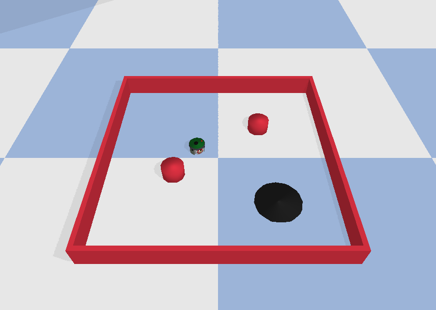</a>
  <a href="docs/img/twin_robot.png">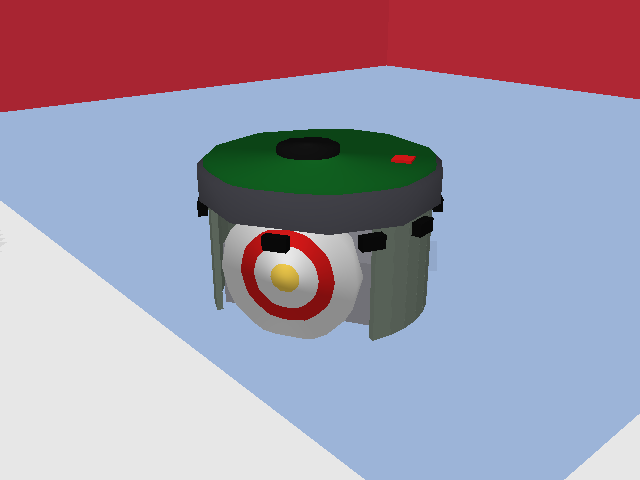</a>
</p>

<p>
  <a href="docs/img/real_arena.jpg">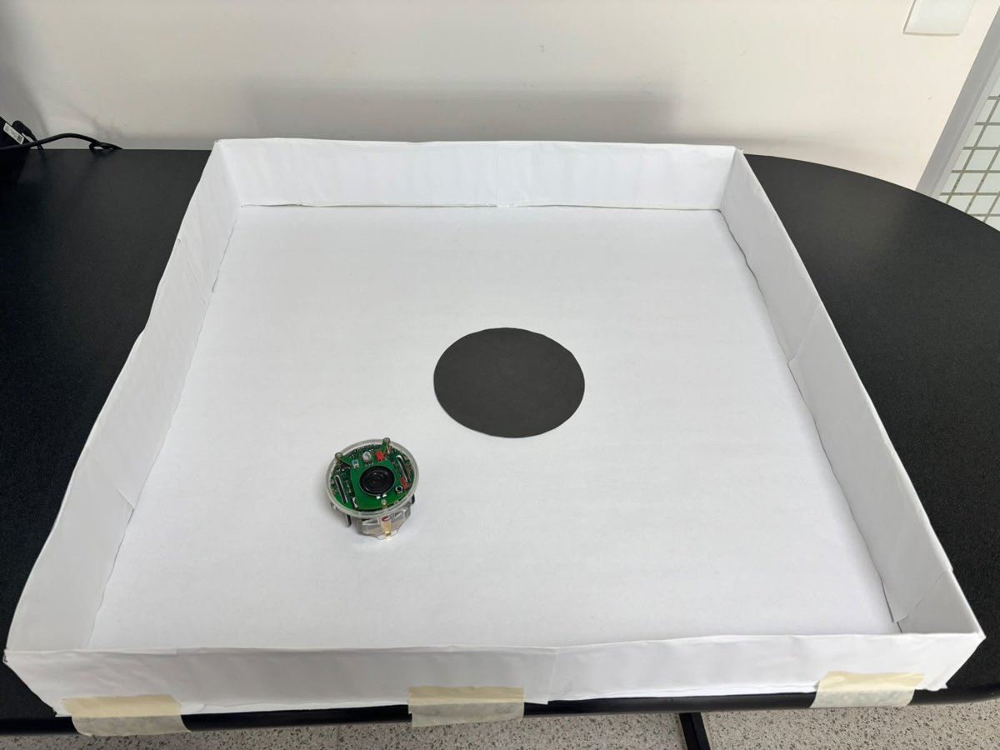</a>
</p>

The real arena: 63 x 63 cm, white foam-board walls about 9 cm high, white
floor, a 15 cm black food patch printed with a laser printer
(`docs/food_patch_circles.pdf`; print at 100%).

<!-- More photos or screenshots: put the files in docs/img and uncomment.
<p>
  <a href="docs/img/twin_gui.png"></a>
</p>
-->

## Install

macOS / Linux, recommended with conda (miniforge), which ships a prebuilt
pybullet:

```bash
scripts/setup.sh              # conda env 'epuck-remote' (or .venv without conda); runs the tests
conda activate epuck-remote
```

Windows 10/11 (real robot and mock; the twin is easier on macOS/Linux):
install Python from python.org with "Add python.exe to PATH", then

```
scripts\win\setup.bat         :: creates .venv, installs numpy matplotlib pyserial, runs the tests
.venv\Scripts\activate
```

## Quick start

One launcher works on every system:
`python scripts/epuck.py <command> <target> [options]`, where `target` is
`mock`, `sim`, `sim-gui`, a serial port (`COM5`, `/dev/rfcomm0`,
`/dev/cu.e-puck_2473`) or a profile (`calib/profile_2473_real.json`).
The same commands exist as `scripts/*.sh` (macOS/Linux) and
`scripts\win\*.bat` (Windows).

```bash
python scripts/epuck.py test                                     # smoke tests
python scripts/epuck.py run mock --duration 20                   # Braitenberg on the mock robot
python scripts/epuck.py run sim-gui --duration 60                # same controller, PyBullet GUI
python scripts/epuck.py run calib/profile_twin_2473.json --gui   # the twin, timed like the real robot
```

Real robot: selector at 3, reset (the robot must stay still and quiet, only
the green LED on), pair it, find its port (`docs/bluetooth.md`), then:

```
python scripts/epuck.py probe COM5                                # version, sensors, latency
python scripts/epuck.py run calib/profile_2473_real.json --duration 30
```

**Safety:** the asercom firmware has no watchdog. If the Bluetooth link is
lost while the robot moves, it keeps its last wheel speeds and no program
can stop it: keep a hand near its power switch. The programs stop the
wheels when they connect, retry the stop for ~2 s at the end or on Ctrl-C,
and print a warning if they could not.

Every run writes `runs/<date>_<target>.csv`, a `_meta.json` with the
options and world layout, and the figures (proximity and ground-sensor
heatmaps, wheel commands, trajectory for mock/sim). Ctrl-C stops the robot;
the motors are also stopped after too many link errors, and closing the
PyBullet window ends a sim run keeping its log.

## Figures

Every run writes these figures; the ones below come from the twin timed
like robot 2473 (60 s, 5 Hz, `calib/profile_twin_2473.json`) and from the
first run of the real robot. All are generated by the code
(`python scripts/make_readme_figures.py` regenerates the twin ones).

| | |
|---|---|
| [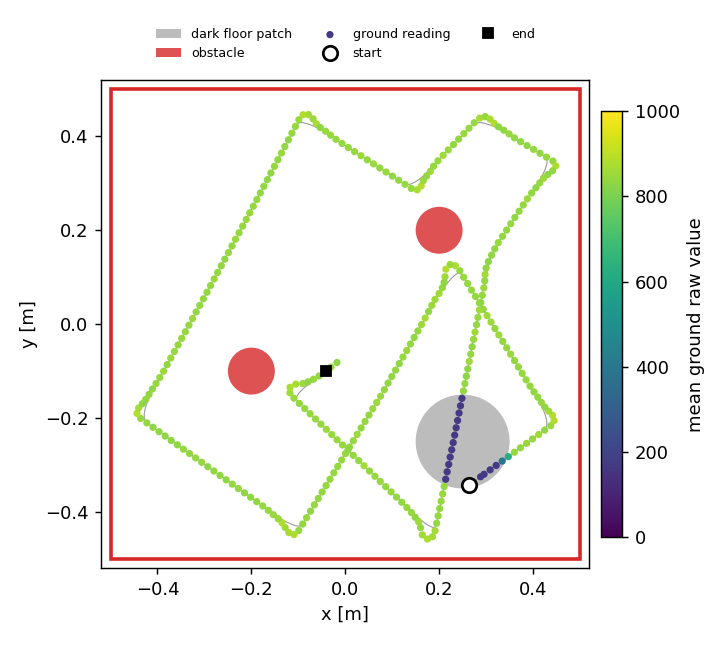](docs/img/twin_run_trajectory.png) | [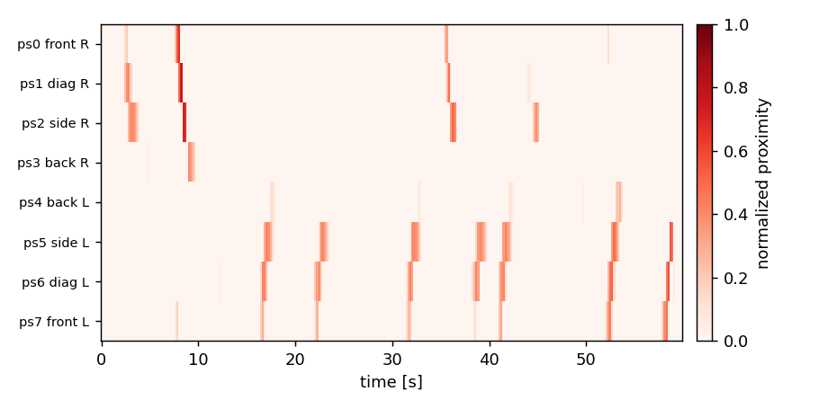](docs/img/twin_run_proximity.png) |
| Twin: path coloured by the ground-sensor reading (obstacles in red, dark patch in grey) | Twin: IR proximity, one row per sensor |
| [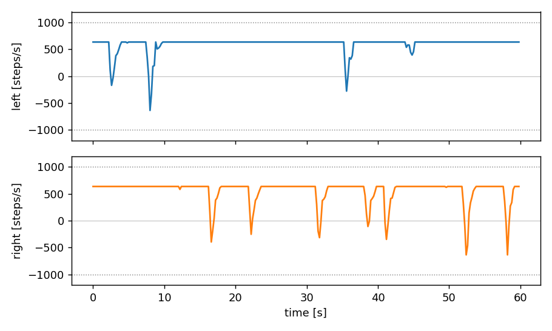](docs/img/twin_run_wheel_commands.png) | [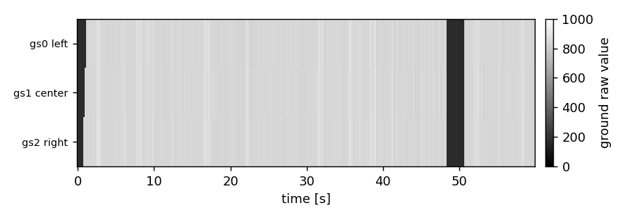](docs/img/twin_run_ground_sensors.png) |
| Twin: wheel commands; a dip of one wheel is a turn away from an obstacle | Twin: ground sensors; dark bands are the patch |
| [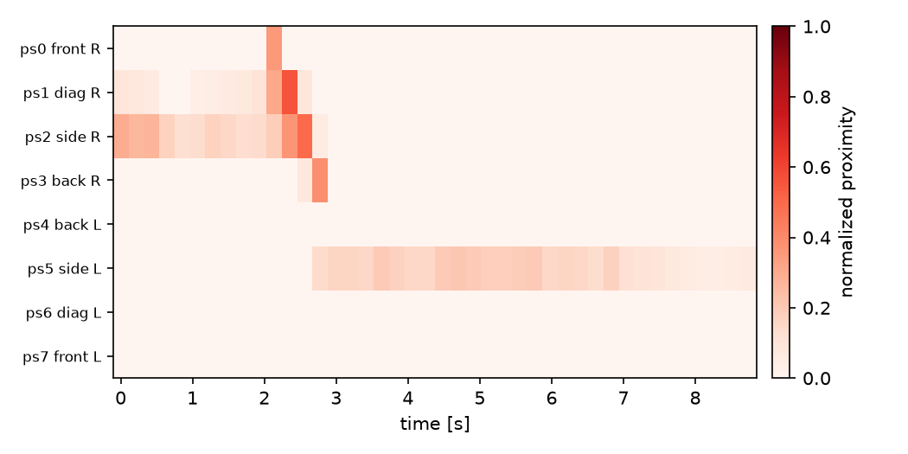](docs/img/real_first_run_proximity.png) | [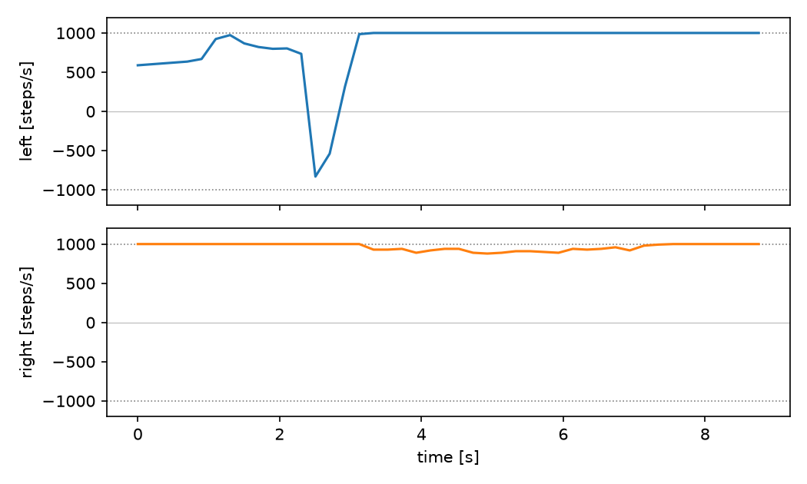](docs/img/real_first_run_wheel_commands.png) |
| Real robot 2473, first run: the wall seen on the right (ps0-ps2) at 2-3 s... | ...and the turn away from it (left wheel down to -830 steps/s) |

[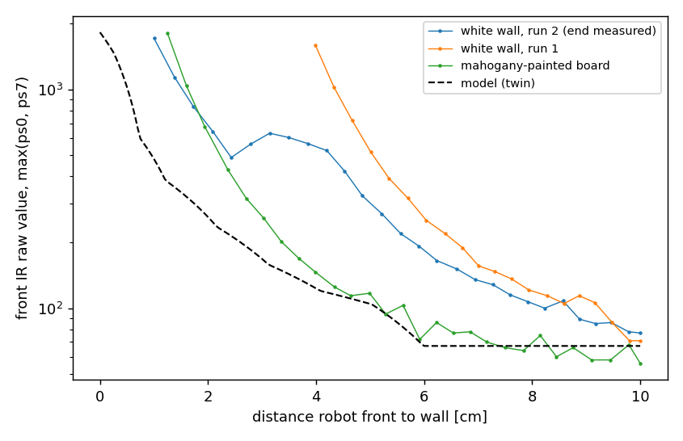](docs/img/ir_approach_real_vs_model_front_ir_vs_distance.png)

Front IR of robot 2473 approaching a wall, against the model of the twin:
a white wall reads about 3-4 cm closer than the model, a mahogany-painted
board about 1 cm (`--ir-shift`, `docs/calibration.md`). Data: `docs/data`.

## Food-finding demo

`--controller forager`: the robot explores with the Braitenberg (plus a
random turn now and then, so it also crosses the middle of the arena); when
its ground sensors see the dark patch it moves onto it, spins 5 full turns,
drives off, ignores food for 4 s and searches again. Every find is logged
(`state` column, `<log>_summary.json`) and marked with a star on the
trajectory figure. The ground sensors are read every step (`--floor` is
switched on by itself).

```
python scripts/epuck.py run calib/profile_twin_arena63.json --controller forager --gui --duration 180   # twin of the arena
python scripts/epuck.py run calib/profile_2292_real.json --controller forager --duration 180            # robot 2292 (Windows)
```

Knobs: `--food-threshold` (raw ground value below which the floor is food:
twin 500, robot 2292 330, both set in the profiles), `--spins`,
`--spin-speed`, `--advance-time`, `--leave-time`, `--ignore-time`,
`--wander-interval`, `--wander-time`. In the twin of the 63 cm arena it
found the 15 cm patch 2-6 times per 3 minutes (34 finds in 8 runs).

| | |
|---|---|
| [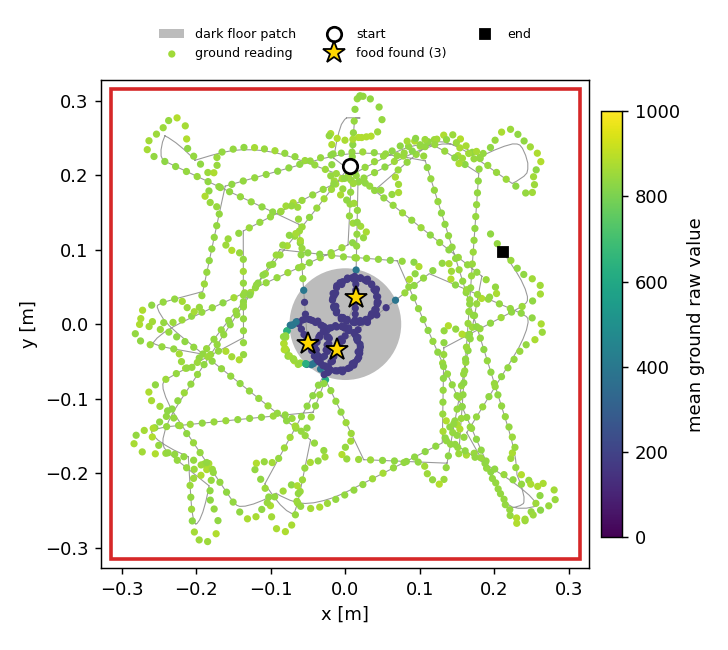](docs/img/twin_forager_trajectory.png) | [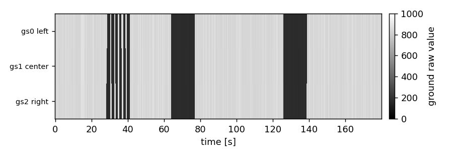](docs/img/twin_forager_ground_sensors.png) |
| Twin, 3 min: stars where the food was found; the purple rings are the ground sensors circling on the patch while the robot spins | Ground sensors over time: each dark band is a visit to the food |

## Video of the twin

`--video file.mp4` records the twin without opening a window, at 25 frames
per second of simulated time, so the video is smooth whatever the speed of
the computer (rendering is in software: about 4 s of computing per second
of video at 800x600; `--video-size 640x480` is faster). Needs `imageio` and
`imageio-ffmpeg` (in `environment.yml`; or `pip install imageio imageio-ffmpeg`).

```
python scripts/epuck.py run calib/profile_twin_arena63.json --controller forager --duration 60 --video runs/forager.mp4
```

Camera: `--video-yaw 90` turns it 90 deg counter-clockwise around the
arena (seen from above), `--video-top` looks straight down.

With `--gui` the window is now updated through each control step instead of
jumping every 0.2 s. On macOS the PyBullet window has twice closed by itself
during a run; the run then stops and keeps its log. Recording a video
avoids the window altogether.

## Commands

`python -m epuck_remote.cli <command> --backend {mock,sim,real} ...`
(`--help` on each command lists every option)

- `probe`: firmware version, sensors, step counters, round-trip latency.
- `baseline`: mean and std of the IR in open space, for the adapter.
- `run`: closed loop, sensors -> controller -> wheels, CSV log (`--log auto --plot`).
- `drive`: fixed wheel command; expected vs measured motion (speed, turn and trim calibration).
- `approach`: slow drive toward a wall, raw IR vs distance (IR calibration).

`python -m epuck_remote.plot approach --csv <files> --model --measured-end <cm>`
overlays approach logs on the model and prints the estimated `--ir-shift`.

## Profiles and calibration knobs

A profile is a JSON of option defaults (`--profile file.json`); options
given on the command line win. `calib/profile_2473_real.json` holds the
calibration of robot 2473, `calib/profile_twin_2473.json` times the twin
like it. Procedure and formulas: `docs/calibration.md`.

| knob | what it corrects | 2473 (wood floor) | 2292 (arena) |
|------|------------------|------|------|
| `--hz` | control rate the Bluetooth link sustains | 5 (~85 ms/command) | 5 (~56 ms/command) |
| `--max-speed` | at 5 Hz full speed reacts too late | 0.08 m/s | 0.08 m/s |
| `--speed-scale` | wheels cover more or less than the model | 0.93 | 0.975 |
| `--turn-scale` | turning differs from the model even with speed corrected | 1.10 | 1.05 |
| `--trim` | the robot drifts sideways on a straight command | 0 (not measured) | 0 |
| `--calib` / `--auto-baseline` | per-sensor IR background | `baseline_2473.json` | `baseline_2292.json` |
| `--ir-margin` | backgrounds that drift between places | 30 | 30 |
| `--ir-shift` | wall colour: white reads closer than the model | 0.035 white, ~0.01 painted wood | 0.02 white |
| `--ir-range`, `--ir-gain`, `--ir-nsigma` | IR range, sensitivity, noise threshold | defaults | defaults |
| `--sim-latency` | twin only: delay between reading sensors and acting | 0.085 | 0.085 |

Each robot has its own profile (`calib/profile_2473_real.json`,
`calib/profile_2292_real.json`); `calib/profile_twin_arena63.json` is the
twin of the real 63 cm arena with its 15 cm food patch. Ground sensors of
2292: floor 407-588, black patch 145-226, threshold ~330.

## Controllers

`controllers/braitenberg_avoidance.json` is read by `BraitenbergJSON`
(`epuck_remote/controllers.py`). Any class with `reset()` and
`step(obs) -> (v_left, v_right)` in m/s can be loaded with
`--controller path/file.py:ClassName --ctrl-arg <argument>`.
`obs` holds the normalized IR (`prox`, in the chosen order), the native
order (`prox_native`), the raw IR, the ground sensors and the time.

The Braitenberg JSON's bias (0.3) is larger than its `max_speed` (0.15), so
read literally (`--brait-mode absolute`) both wheels saturate and the robot
cannot steer; the default `relative` mode scales instead of clipping. Its
weights steer away from obstacles in the native ps0..ps7 order (checked in
the twin and on the real robot). The escape from a head-on wall is set in
seconds (`--stuck-time`, `--back-time`, `--turn-time`), so it lasts the same
at any `--hz`.

## Known issues

- macOS: data flows only in the **first session after pairing** (the
  link comes up ~2.5 s after the port opens; the programs wait for it,
  `--connect-timeout`). In later sessions the link may come up (Bluetooth
  LED on) but no data passes, even after resetting the robot; forgetting
  and pairing again restores one session. Same with robots 2473 and 2292
  and with both firmware builds, so it is macOS, not the robots.
  **Use Windows for the real robot**, or re-pair before each session on a
  Mac. Planned fix: a bridge that keeps the first session open
  (`TODO.md`).
- Robot 2473: the ground sensors read 0 on every surface (module cable
  under the motors, not checked).
- Bluetooth asercom is slow: ~56-85 ms per command from Windows, so 5 Hz is
  the practical control rate (a step with the ground sensors takes ~135 ms).
  From a MacBook Air the same run took ~225 ms per step (p95 400 ms): use
  `--hz 4` or less on a Mac. With the real robot `--duration` is wall-clock
  seconds.

Open items and ideas: `TODO.md`.

## Layout

```
epuck_remote/   protocol, transports (serial, mock, sim), adapter, controllers, CLI, plots
sim/            PyBullet world and sensors (e-puck part of easabrain) + config.json
robots/         make_epuck_urdf.py and the generated epuck.urdf / epuck_lean.urdf
controllers/    controller parameter files
calib/          calibration results and robot profiles
scripts/        epuck.py launcher, bash scripts, win/ batch files
tests/          smoke tests
docs/           Bluetooth, firmware, calibration, ground sensors, hardware log, provenance
docs/img, docs/data   README figures and the measurements behind them
```

## e-puck resources (GCtronic)

Main page, with the firmware and tools used here:
https://www.gctronic.com/e-puck_links.php

| what | link | status (Oct 2026) |
|------|------|------|
| original firmware, .hex (selector 3 = asercom) | http://projects.gctronic.com/E-Puck/DemoGCtronic-complete/DemoGCtronic-complete-rev123.hex | works: flashed on robot 2292 |
| same firmware, source (MPLAB project) | http://projects.gctronic.com/E-Puck/DemoGCtronic-complete/DemoGCtronic-complete-rev123.zip | listed |
| e-puck Monitor 1.2 / 2.0 (Windows) | https://www.gctronic.com/files/epuckMonitor_1.2.zip, https://www.gctronic.com/files/e-puckMonitor_2.0.rar | works (SmartScreen may block it, see docs/bluetooth.md) |
| snapshot of the e-puck software, Aug 2008 (library, bootloader tools) | http://projects.gctronic.com/E-Puck/e-puck-gna-svn-rev113.zip | listed |
| EPFL documents licence | https://www.gctronic.com/files/license.pdf | listed |
| Tiny Bootloader ("tiny downloader") | http://www.etc.ugal.ro/cchiculita/software/picbootloader.htm | **dead**: keep a local copy (docs/firmware.md) |
| GNA project (SVN) | https://gna.org/projects/e-puck/ | **dead** (GNA closed) |

Several links on that page are old (Microchip MPLAB/C30, e-puck.org, Webots
download pages) and may no longer work. The .hex files and the Tiny
Bootloader are not included in this repo: download them from GCtronic or
keep your own copies.

## Provenance and licences

See `docs/provenance.md`. The Webots `.proto` files the model was measured
from are not included (Cyberbotics licence: use with Webots only); they are
cited by URL. Code: MIT. How to cite: `CITATION.cff` (GitHub shows a
"Cite this repository" button).
